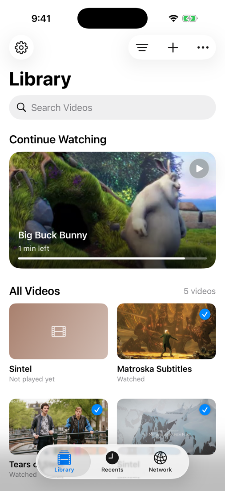
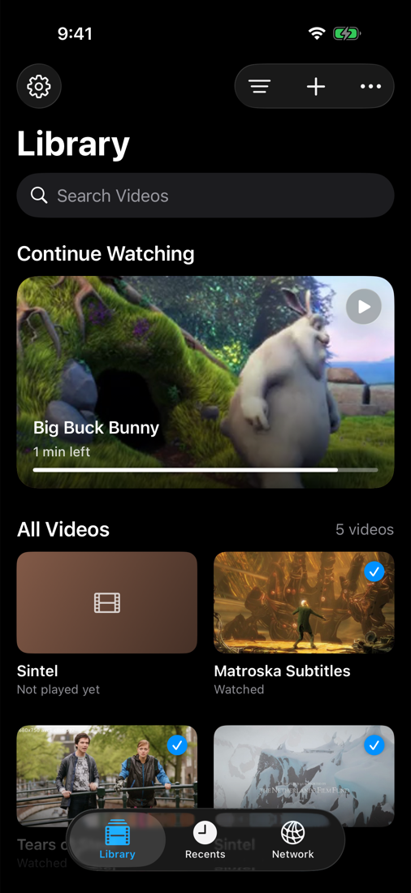
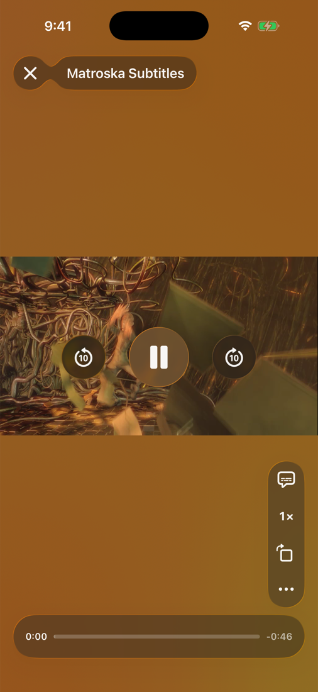
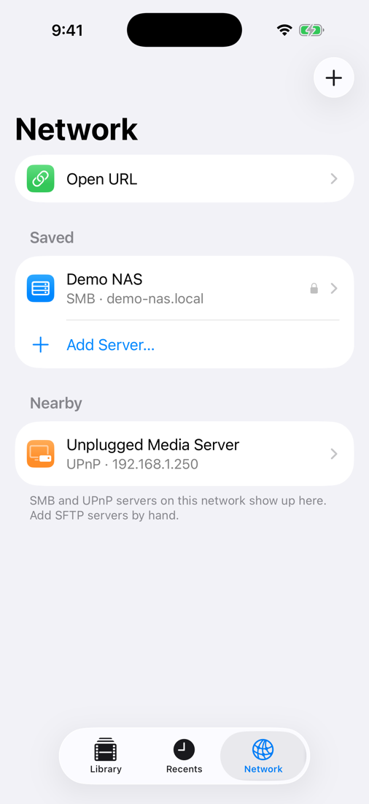
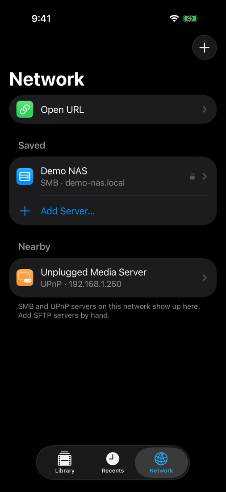
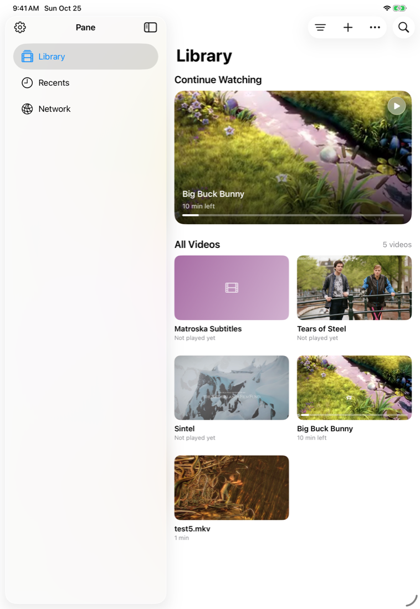
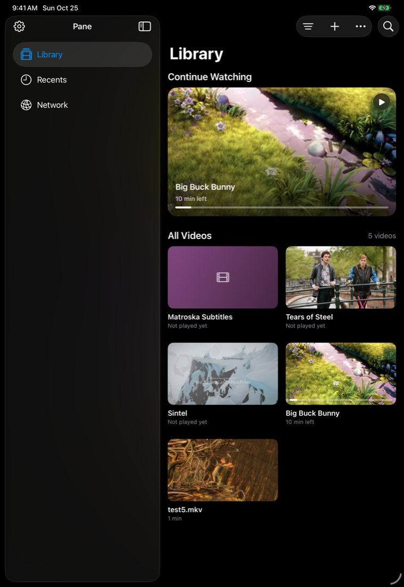
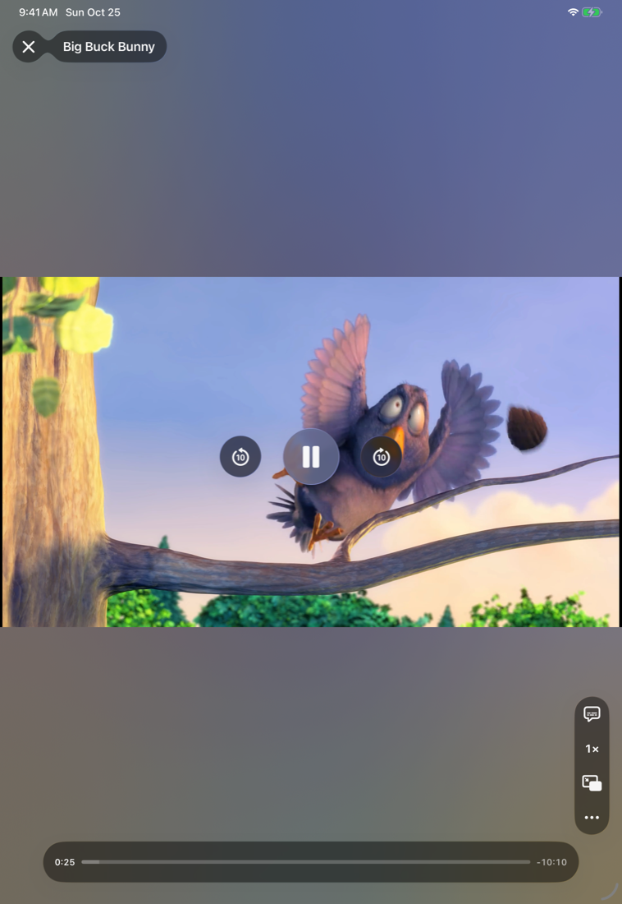

# Pane

Pane is a video player for iPhone, iPad and Mac. It plays the files you already have, from wherever they are, without converting or copying them.

## What it does

- Plays almost any video file: MKV, MP4, AVI, WebM, MOV, TS and more, with the audio and subtitle tracks inside them.
- Opens files in place from Files and Finder, and whole folders, and keeps them in one library with posters and where you stopped.
- Streams from a URL (HLS, RTSP, RTMP, HTTP) and browses SMB, SFTP and UPnP servers on your network.
- Picks your preferred audio and subtitle languages, adds external subtitle files, and lets you nudge subtitle timing or sync it by ear.
- Speed control, volume boost past 100%, A-B loop, frame step, sleep timer, chapters, fit or fill, and saving a frame to Photos.
- Spreads the colors of the scene on screen behind the picture, so the letterbox and the glass controls glow with the film.
- Picture in Picture, Handoff between devices, and optional iCloud sync of your library and progress.
- Light, dark or system appearance.

## Built on VLC

Pane plays everything through [VLCKit](https://code.videolan.org/videolan/VLCKit), the Apple-platform framework around [libVLC](https://www.videolan.org/vlc/libvlc.html) from VideoLAN, the engine inside VLC. Decoding, demuxing, subtitles, network protocols and hardware acceleration all come from VLC. VLCKit and libVLC are licensed under the GNU LGPL 2.1 or later.

## Screenshots

### iPhone

Library, light

Library, dark

Player

Network, light

Network, dark

### iPad

Library, light

Library, dark

Player

